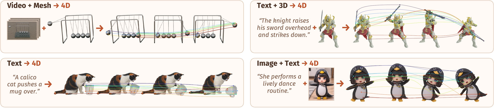
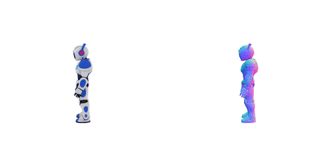
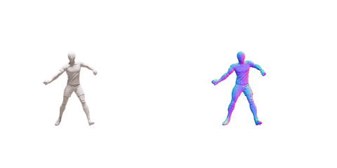
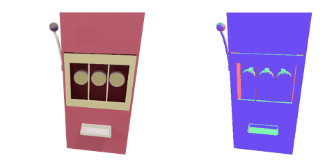
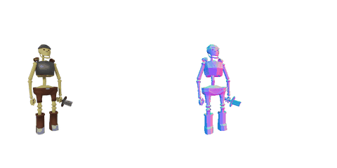
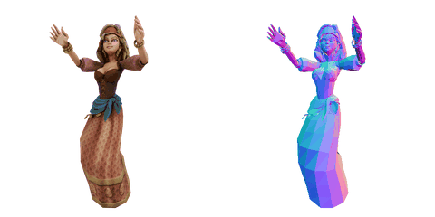
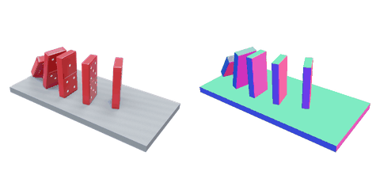

# Anchor4D: Geodesic-Aware Attention for Video-Driven Mesh Animation

[Project page](https://tianhang-cheng.github.io/Anchor4D/) · [Weights](https://huggingface.co/TianhangCheng7/Anchor4D) · [Evaluation data](https://huggingface.co/datasets/TianhangCheng7/Anchor4D-Eval)



Anchor4D animates a given triangle mesh from a video. It keeps the mesh topology fixed and outputs per-vertex positions
for every frame. A mesh-sequence VAE compresses each 16-frame window into 512 anchor latents with geodesic-aware attention;
a video-conditioned flow transformer generates these latents from Wan2.2 video features, the camera and point-tracking
correlations.

This repository contains inference and evaluation code and the released weights. The training dataset and training code
will follow (see TODO).

## Install

```bash
conda env create -f environment.yml      # creates the env "aa" (Python 3.11, PyTorch 2.7, CUDA 12.8 wheels)
conda activate aa
# or: uv venv --python 3.11 && uv pip install -r requirements.txt --index-strategy unsafe-best-match
```

For another CUDA version, install the matching `torch==2.7.0` / `torchvision==0.22.0` wheels first. Inference needs about
10 GB of GPU memory for a 120K-vertex mesh and takes a few seconds per 64-frame clip.

## Weights

```bash
hf download TianhangCheng7/Anchor4D --include "anchor4d/*" --local-dir checkpoints   # 0.8 GB
python scripts/download_wan.py --out checkpoints/Wan2.2-TI2V-5B                      # 12.6 GB of Wan2.2-TI2V-5B
```

Only the VAE encoder and the first 11 transformer blocks of Wan2.2-TI2V-5B are used, as a frozen video encoder; the
script downloads just the files that hold them.

## Animate a mesh with a video

```bash
python scripts/infer.py --mesh mesh.obj --frames frames/ --camera camera.json --out outputs/my_clip [--obj]
```

- `--mesh`: the object at frame 0 (obj / ply / glb, ...), in world coordinates. Vertices at the same position are
  welded (UV seams split them in most exported meshes); `--weld-eps` merges near-duplicates.
- `--frames`: at least 16 square RGBA frames (png / webp), the object over a transparent background. Clips of any length
  are processed in overlapping 16-frame windows.
- `--camera`: a static camera in the NeRF-synthetic convention,
  `{"camera_angle_x": <horizontal FOV, radians>, "transform_matrix": <4x4 camera-to-world, OpenGL axes>}`.
- Output: `animation.npz` with `vertices` [T, V, 3] (world coordinates, input vertex order) and `faces`; `--obj` also
  writes one .obj per frame.

Sampling uses 4 Euler steps; `--seed` changes the sample.

### Examples

Eight examples (frame-0 mesh, RGBA video, camera, the exact command in `command.txt`, the expected output
`reference.npz`, and credits):

```bash
hf download TianhangCheng7/Anchor4D --include "examples/*" --local-dir .
bash -c "$(cat examples/penguin_girl/command.txt)"
```

| example | frames | input | input video / our output |
|---|---|---|---|
| `penguin_girl` | 128 | image -> mesh, generated dance video |  |
| `calico_cat_mug` | 64 | text -> generated video -> frame-0 mesh (two objects) |  |
| `robot_backflip` | 128 | 3D asset + generated video (slow backflip) |  |
| `mannequin_dancer` | 512 | video -> frame-0 mesh |  |
| `slot_machine` | 64 | synthetic: articulated object (Articraft) |  |
| `skeleton_warrior` | 64 | synthetic: skinned character (Objaverse) |  |
| `peasant_girl` | 64 | synthetic: skinned character (TexVerse) |  |
| `domino_chain` | 64 | synthetic: multi-body simulation (Anchor4D-Syn) |  |

The synthetic examples come from the evaluation set and also include `ground_truth.npz`; their commands use the clip's
seed and `--no-weld` (dataset meshes keep intentionally separate vertices), so the output equals the paper's prediction.
The outputs match `reference.npz` exactly on our machines. GIFs: input video (left) and our output from the input
camera with camera-space normal shading (right); long clips are subsampled to 64 frames.

## Real videos

`scripts/realvideo/` turns a real video (moving camera allowed) into the inputs above: camera estimation, object masks,
completion of occluded object parts, frame-0 mesh reconstruction (Hi3D), and then runs Anchor4D in a virtual camera.
Each stage uses the upstream project's own environment; see [scripts/realvideo/README.md](scripts/realvideo/README.md).

## Evaluation

The evaluation data is on [TianhangCheng7/Anchor4D-Eval](https://huggingface.co/datasets/TianhangCheng7/Anchor4D-Eval).
The video-to-4D benchmark of the paper has 500 clips from seven sources (Articraft, Objaverse, TexVerse,
DeformingThings4D, our simulated Anchor4D-Syn, 4DCodeBench, ARCTIC). Each clip in the evaluation package holds the
frame-0 mesh, the RGBA video, the camera, the per-clip seed, the ground-truth vertices, surface samples and the two
scoring cameras. DeformingThings4D and ARCTIC data may not be redistributed: for those clips the dataset has a
recipe, and `scripts/eval/rebuild_restricted.py` regenerates the identical geometry from your own official download. The
ARCTIC input videos are not distributed, so the public video-to-4D benchmark has 467 clips (all 500 in the paper).

```bash
python scripts/eval/run_benchmark.py --package data/anchor4d_eval/gen --out outputs/eval   # --shard i/n to split over GPUs
python scripts/eval/score.py --package data/anchor4d_eval/gen --pred outputs/eval
```

Metrics (clip means; positions in units of the frame-0 bounding-box longest edge): EPE (x100), EPE-2D (pixels at 512),
Normal (degrees), Accel (x100), Chamfer (x100), silhouette IoU in the input and in a held-out view (%). The released
weights reproduce the paper's numbers exactly:

| | EPE | EPE-2D | Normal | Accel | CD | IoU (novel view) | Time (s) |
|---|---|---|---|---|---|---|---|
| Anchor4D | 5.00 | 9.3 | 12.1 | 0.334 | 2.19 | 76.4 | 4.4 |

Inference is deterministic for a given input, seed and GPU software stack. The benchmark feeds each clip exactly as in
the paper; rescaling or re-exporting the inputs changes floating-point rounding and gives a slightly different sample.

**VAE reconstruction** (464 clips; each 16-frame window is encoded from the ground truth and decoded from the previous
decoded frame, only frame 0 is given):

```bash
python scripts/eval/run_reconstruction.py --package data/anchor4d_eval/recon --out outputs/recon
python scripts/eval/score.py --task recon --package data/anchor4d_eval/recon --pred outputs/recon
```

| | EPE | Last | EPE-Max | Normal | Edge | CD-L1 | IoU (novel view) | CTE |
|---|---|---|---|---|---|---|---|---|
| Anchor4D (C=32) | 0.405 | 0.659 | 1.96 | 3.73 | 2.36 | 0.285 | 95.9 | 0.286 |

**R-DMesh fine-tuned** (the R-DMesh† baseline): `rdmesh_finetuned/` on the weights page uses the layout of the official
[R-DMesh](https://github.com/Tencent-Hunyuan/R-DMesh) `ckpts` folder; replace the two weight files and run their
inference code.

## TODO

- [x] Inference code, weights and examples (2026-11-23)
- [x] Evaluation code and data: video-to-4D and VAE reconstruction (2026-11-23)
- [x] Real-video pipeline (2026-11-23)
- [x] R-DMesh fine-tuned weights (2026-11-23)
- [ ] Full training dataset
- [ ] Training code
- [ ] Text / image / 3D asset + text to 4D (a video generator produces the driving video, then Anchor4D)

## License

The code in this repository is released under the Apache License 2.0 (see [LICENSE](LICENSE)); third-party parts keep
their licenses, listed in [NOTICE](NOTICE). The weights have their own terms, listed on the
[weights page](https://huggingface.co/TianhangCheng7/Anchor4D): copyright of R-DMesh (its architecture and released
weights, which initialize our generator) belongs to the R-DMesh authors.

## Acknowledgements

We build on [R-DMesh](https://github.com/Tencent-Hunyuan/R-DMesh), [AnimateAnyMesh](https://github.com/JarrentWu1031/AnimateAnyMesh),
[Wan2.2](https://github.com/Wan-Video/Wan2.2) and [AllTracker](https://github.com/aharley/alltracker).
